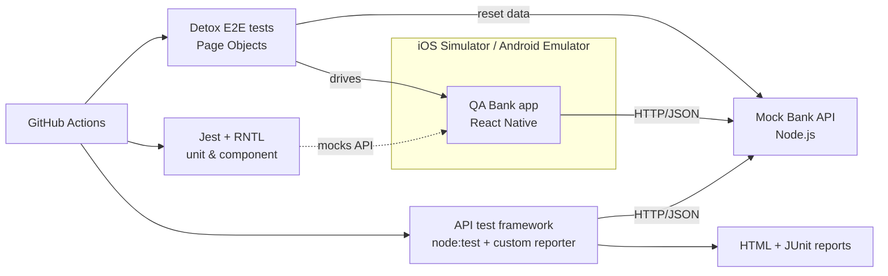

# QA Portfolio – QA Bank

A small but realistic banking product, built and tested end to end to show how I approach quality on a mobile team: from requirements and manual test design through to automated API and UI tests running in CI.


| Folder | What it is | Tech |
|--------|------------|------|
| [`mobile-app/`](mobile-app) | React Native banking app (login, accounts, transactions, payments) with unit, component and Detox E2E tests | React Native, Expo, TypeScript, Jest, React Native Testing Library, Detox |
| [`mock-server/`](mock-server) | Mock banking API with realistic business rules and fault injection | Node.js, TypeScript, zero runtime dependencies |
| [`api-test-framework/`](api-test-framework) | API test automation framework with custom HTML reporting | TypeScript, `node:test`, custom reporter, JUnit output |
| [`docs/`](docs) | Test plan, requirements, manual test cases, bug reports, exploratory charters, traceability matrix | Markdown |
| [`.github/workflows/`](.github/workflows) | CI pipeline: type checks, unit, API and nightly Detox runs | GitHub Actions |

## Architecture



## Test pyramid

| Level | Count | Runs |
|-------|-------|------|
| Unit + component (Jest) | 56 | every push |
| API (custom framework) | 63 | every push |
| E2E UI (Detox) | 21 | nightly / on demand |
| Manual scripted | 35 cases | each release candidate |
| Exploratory | 4 charters | each new feature |

## Highlights

- **Money handled as integer pence everywhere** – avoids floating-point bugs like `19.99 * 100 = 1998.9999…`.
- **Idempotency keys on payments** – retrying after a timeout or double-tapping cannot pay twice; tested at API level.
- **Security basics tested** – no user enumeration on login, 404 (not 403) for other customers' accounts, passwords never returned.
- **Fault injection** in the mock server (`x-mock-delay-ms`, `x-mock-status`, `POST /__test/config`) to test timeouts, retries and error messages.
- **Boundary value analysis** on balance, daily limit, reference length and pagination.
- **Real bugs found and logged** – see [docs/bug-reports.md](docs/bug-reports.md); fixed bugs get a regression test.

## Quick start

Requirements: Node.js 22+. For the mobile app also Xcode (iOS) and/or Android Studio (Android).

```bash
# 1. API tests (no phone needed) – starts the mock server for you
cd mock-server && npm install && cd ..
cd api-test-framework && npm install && npm run test:local
# open api-test-framework/reports/api-report.html

# 2. Mobile unit tests
cd mobile-app && npm install && npx expo install --fix && npm test
```

Running the app and Detox tests: see [mobile-app/README.md](mobile-app/README.md).

## About me

Ezekiel Folarin – Computer Science Graduate · folarinezekiel50@gmail.com
